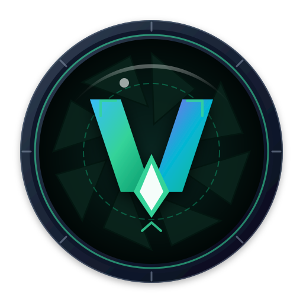

<p align="center">
  
</p>

# vView (Vala View)

**vView** is a lightweight, blazing-fast, and minimalist image viewer and quick annotation editor for Linux, built with **Vala**, **GTK4**, and **Libadwaita**.

It seamlessly integrates with GNOME desktop environments following the GNOME Human Interface Guidelines (HIG), while functioning smoothly across all other desktop environments (KDE Plasma, XFCE, etc.).

The compiled binary is only **~45 KB**, and compile times are under **1 second**.

---

## Supported Image Formats

vView supports all standard modern image and vector formats out of the box:

| Format | Extensions | Features & Capabilities |
| :--- | :--- | :--- |
| **JPEG** | `.jpg`, `.jpeg` | High-quality 95% save, EXIF metadata extraction & camera info |
| **PNG** | `.png` | Lossless raster graphics with transparency support |
| **WebP** | `.webp` | Modern web format with high compression and transparency |
| **GIF** | `.gif` | Static and animated graphic format support |
| **SVG** | `.svg` | Crisp vector graphics rendering via `librsvg`; annotated edits export directly to PNG |

---

## Quick Notes & Annotation Editor

vView includes a built-in lightweight annotation toolbar designed for taking quick notes, marking up screenshots, pointing out interface bugs, and masking confidential data before sharing images.

Press **`E`** (or click the edit button in the header bar) to reveal the toolbar:

* ✏️ **Straight Lines & Scalable Arrows:** Direct attention to specific UI elements or details with clean, anti-aliased directional arrows and lines.
* 🔲 **Shapes (Rectangle & Circle):** Highlight or frame regions of interest with adjustable stroke thickness.
* 🔢 **Numbered Step Badges (1, 2, 3...):** Sequentially number steps and workflows on screenshots with auto-incrementing numbered circles. Badges automatically renumber if an intermediate badge is deleted, and can be moved or customized with custom fonts and colors.
* 💬 **Quick Text Notes & Badges:** Click anywhere on the image to type notes and labels. Features background badges for readability against any background and full system font selection (`FontChooserDialog`).
* ⬛ **Redaction & Privacy Masking (Mosaic Pixelation):** Drag a box over sensitive information (passwords, email addresses, personal data) to apply smooth mosaic pixelation.
* 🖐️ **Select & Move:** Reposition any annotation item after drawing it.
* 🎨 **Color & Stroke Customization:** Choose any stroke or text color with the color picker, and adjust line width from 1 px to 50 px with real-time preview.
* ↩️ **Full Undo & Redo History:** Safely revert or re-apply any editing action using `Ctrl + Z` and `Ctrl + Y` (or `Ctrl + Shift + Z`).
* 💾 **Lossless In-Memory Workflow:** Edits are kept in memory until you choose to **Save** (`Ctrl + S`) or **Save As…** (`Ctrl + Shift + S`).

---

## Features

* 🎨 **Native GNOME Experience:** Rounded window corners, adaptive `Adw.HeaderBar`, and automatic system dark/light style support.
* 🖥️ **Fullscreen Mode:**
  * Toggle using the `F` key or double-clicking the mouse.
  * The header bar automatically hides in fullscreen.
  * **Auto-hiding cursor:** The mouse cursor vanishes after 2 seconds of inactivity and reappears upon movement.
* 📁 **Smart Directory Navigation:**
  * Opens the requested image and gathers all supported images in the same directory.
  * Infinite looping (navigating past the last image loops back to the first).
  * Fast navigation via arrow keys, Space, Page Up/Down, or mouse scroll wheel.
* 🔄 **In-Memory Rotation & Flexible Saving:**
  * Rotate images clockwise (`R`) or counter-clockwise (`L`) in-memory without altering the original file immediately.
  * A prominent **Save** button appears in the header bar as soon as changes are made.
  * Choice between **Overwrite** (save directly into the current file) and **Save As…** (choose directory and filename via native `Gtk.FileDialog`).
  * Preserves original file format and high visual fidelity (JPEG/WebP quality 95, lossless PNG/GIF).
* ℹ️ **Image Properties & Metadata Panel (`Alt + Enter` / `Ctrl + I`):**
  * Displays native resolution, megapixels, file size, MIME type, dates, and camera EXIF information.
  * Quick-action buttons to open containing folder in file manager or copy path to clipboard.
* 🎞️ **Slideshow Mode (`F5`):**
  * Automatic continuous looping through folder images starting from the current slide.
  * Preserved across fullscreen toggles and metadata panel toggles.
  * Pause/play at any time via HeaderBar button or `F5`.
* ⚙️ **Preferences Dialog (`Ctrl + ,`):**
  * Configurable image fit mode (always stretch to fit window or show small images at 100% native size).
  * Configurable slideshow delay (default: 3 seconds, range: 1–60 seconds).
* 🖱️ **Mouse Scroll Navigation:** Instantly switch to the next/previous image by scrolling the mouse wheel.
* ⌨️ **Ergonomic Shortcuts & Wide Info Dialog:** Intuitive keyboard navigation and a wide, readable shortcuts overlay (`F1` or `[i]`).
* 🏷️ **Clear Window Title:** Displays the full path of the current image: `vView - /path/to/image.jpg`.

---

## Controls

### Keyboard

| Key | Action |
| :--- | :--- |
| `F` | Toggle fullscreen mode |
| `Escape` | Exit fullscreen mode or hide editing toolbar |
| `F5` | Toggle slideshow playback |
| `E` | Toggle editing & annotation toolbar |
| `Ctrl + Z` | Undo last edit or rotation |
| `Ctrl + Y` / `Ctrl + Shift + Z` | Redo last undone action |
| `R` | Rotate image clockwise (90°) |
| `L` | Rotate image counter-clockwise (90°) |
| `Ctrl + 0` | Toggle 100% actual resolution / Fit to window |
| `Alt + Enter` / `Ctrl + I` | Toggle image properties & metadata panel |
| `Ctrl + ,` | Open preferences dialog |
| `Ctrl + S` | Save image (prompt: Overwrite or Save As…) |
| `Ctrl + Shift + S` | Direct "Save As…" (file chooser dialog) |
| `Delete` | Move image to trash (confirmation dialog) |
| `→` / `Space` / `Page Down` | Next image (when not actively drawing) |
| `←` / `Page Up` | Previous image (when not actively drawing) |
| `Home` | Jump to first image in directory |
| `End` | Jump to last image in directory |
| `F1` | Show keyboard shortcuts & info dialog |
| `Ctrl + Q` | Quit application |

### Mouse

| Action | Description |
| :--- | :--- |
| **Scroll Wheel Down** | Next image |
| **Scroll Wheel Up** | Previous image |
| **Double Click (Left Button)** | Toggle fullscreen mode |
| **Idle for 2 seconds (Fullscreen)** | Automatically hide cursor |

---

## Prerequisites & Setup (e.g. ALT Linux)

To clone, build, and continue development on a fresh machine (such as **ALT Linux Workstation / p10 / p11**), install the essential build tools, compiler, and development libraries:

### ALT Linux

Run the following command to install all necessary packages (including WebP decoding and icon generation support):

```bash
sudo apt-get update && sudo apt-get install -y \
    git \
    make \
    gcc \
    vala \
    libgtk4-devel \
    libadwaita-devel \
    libwebp-pixbuf-loader \
    python3-module-pycairo \
    python3-module-pygobject3 \
    librsvg-gir
```

*(Optional: install `gobject-introspection-devel` and `meson` if you plan to introduce GObject Introspection bindings or switch to the Meson build system).*

---

### Other Distributions

* **Ubuntu / Debian:**
  ```bash
  sudo apt update && sudo apt install -y git make gcc valac libgtk-4-dev libadwaita-1-dev webp-pixbuf-loader python3-cairo python3-gi gir1.2-rsvg-2.0
  ```

* **Fedora:**
  ```bash
  sudo dnf install -y git make gcc vala gtk4-devel libadwaita-devel webp-pixbuf-loader python3-cairo python3-gobject librsvg2
  ```

* **Arch Linux:**
  ```bash
  sudo pacman -S --needed git make gcc vala gtk4 libadwaita webp-pixbuf-loader python-cairo python-gobject librsvg
  ```

---

## Building and Running

Compile the binary:

```bash
make build
```

Compile and run immediately:

```bash
make run
```

Clean build artifacts:

```bash
make clean
```

---

## Installation & Desktop Integration

To install `vView` to `~/.local/bin` and register it with the GNOME desktop environment (so it appears in application menus and Nautilus "Open With..." for image files):

```bash
./install.sh install
# or
make install
```

To remove the binary and unregister desktop integration:

```bash
./install.sh uninstall
# or
make uninstall
```

---

## Command Line Usage

vView can be launched with a file or directory path argument (absolute or relative):

```bash
# Open a specific image
./vView /path/to/picture.jpg

# Open relative to the current directory
./vView ./photo.png

# Open a directory (opens the first supported image in the directory)
./vView ~/Pictures/
```

If launched without arguments, it opens a clean window with no image loaded.

---

## Troubleshooting & Tips

### Missing WebP Thumbnails in Nautilus / File Manager
If you previously viewed folders containing `.webp` files before installing `libwebp-pixbuf-loader`, Nautilus caches failed generation attempts in `~/.cache/thumbnails/fail/`. 

To reset the thumbnail cache and force immediate thumbnail generation for all WebP files, run:

```bash
rm -rf ~/.cache/thumbnails/fail/ && nautilus -q
```
